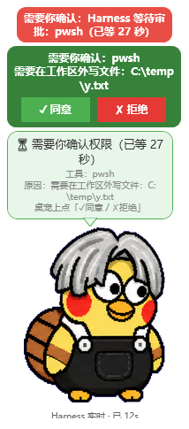
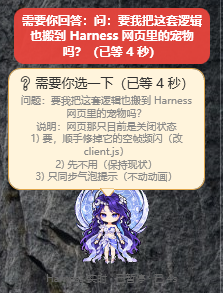
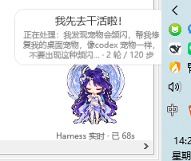
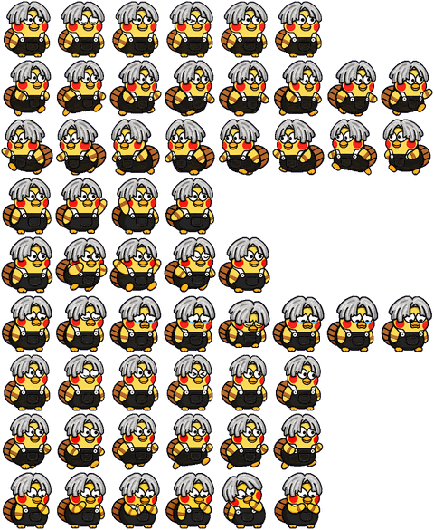
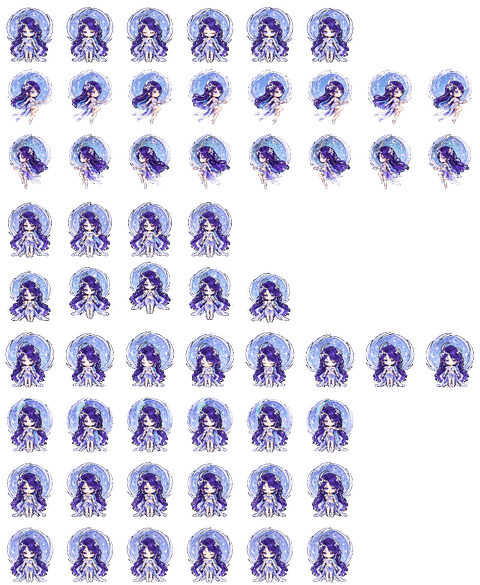

# Kun Like 桌宠 · 桌面版

一只**真正悬浮在 Windows 桌面上**的像素桌宠：始终置顶、可拖动、能换形象，实时播报 **DSH（DeepSeek Harness）** 的任务进展；遇到需要你确认的权限审批时，**直接在桌宠上点「✓ 同意 / ✗ 拒绝」**，不用切回 Harness 窗口。

| 等你审批（桌宠上直接放行） | Agent 向你提问 | 任务进行中 |
|---|---|---|
|  |  |  |

> 纯 **PowerShell + WPF**，Windows 自带组件，**零依赖、零安装**（不需要 Node / Python / .NET 额外运行库）。

---

## 目录

- [这是什么](#这是什么)
- [环境要求](#环境要求)
- [快速开始](#快速开始)
- [功能一览](#功能一览)
- [右键菜单](#右键菜单)
- [装形象素材（换皮肤）](#装形象素材换皮肤)
- [可选：装 DSH 插件（任务进展 + 审批按钮）](#可选装-dsh-插件任务进展--审批按钮)
- [更新到最新版](#更新到最新版)
- [让宠物到处跑（随机移动）](#让宠物到处跑随机移动)
- [跟随 pi coding agent](#跟随-pi-coding-agent)
- [可选：开机自启](#可选开机自启)
- [配置文件](#配置文件)
- [排错](#排错)
- [素材来源与版权](#素材来源与版权)
- [许可](#许可)

---

## 这是什么

仓库里一共三部分，**可以只用第一部分**：

| 目录 | 内容 | 需要 DSH 吗 |
|---|---|---|
| `desktop/` | **桌面桌宠本体**：悬浮在 Windows 桌面上的那只宠物 | 不需要 |
| `plugin/` | **DSH 插件 `@local/kun-pet`（Host 半区）**：给桌面桌宠提供「审批 / 提问」数据通道（`/kun-pet/state` 与 `/kun-pet/approval`）。**不含 Harness 网页内的宠物** | 需要 |
| `pi-extension/` | **pi coding agent 扩展**：把 pi 的运行时状态（尤其是「正在等你确认」）发布给桌宠 | 需要 pi |
| `assets/pets/` | 两只随仓库附带的桌宠形象（`ikkun`、`haiyue-classic`），可直接用 | 不需要 |

**不装 DSH 也能正常用**：桌宠会以待机动画待在桌面上，单击挥手、双击跳一下、拖动移动，只是不会有任务进展气泡。装上 `plugin/` 后它才会跟着任务状态变化。

**装了 pi 也能跟着 pi**：桌宠可以同时跟随 DSH 与 **pi coding agent**（`@earendil-works/pi-coding-agent`），两者互不干扰。见 [跟随 pi coding agent](#跟随-pi-coding-agent)。

---

## 环境要求

- **Windows 10 / 11**（依赖系统自带的 PowerShell 5.1 + WPF，无需额外安装）
- 可选：**DeepSeek Harness**（要用「任务进展提示」和「桌宠上审批」才需要）

> `desktop/kun-pet-desktop.ps1` 是 PowerShell 5.1 脚本，**Windows PowerShell** 可直接运行，
> 不需要 PowerShell 7。若你机器上 `powershell.exe` 被安全策略限制，用
> `powershell -NoProfile -ExecutionPolicy Bypass -File .\desktop\kun-pet-desktop.ps1` 手动跑一次即可看到完整报错。

### 全新用户要注意的三件事（都已实测）

**1. 用 `启动桌宠.vbs` 启动，不要直接双击 `.ps1`。**
`.vbs` 内部自带 `-ExecutionPolicy Bypass`，所以**即使你的系统策略是 `Restricted` 也能起来**
（实测通过）。反过来，直接运行 `.ps1` 在 `Restricted` 下会被拒：

```
File ...\kun-pet-desktop.ps1 cannot be loaded because running scripts is disabled on this system.
```

同样地，想一键安装就双击根目录的 **`安装.cmd`**（它也用 `-ExecutionPolicy Bypass`），
而不是去双击 `install.ps1`。

**2. 不装任何素材也能用。** 没有 `~/.petdex/pets/` 时，桌宠会退回**内置矢量形象**，
照常显示、拖动、跟随任务，不会报错。想换成像素形象见 [装形象素材](#装形象素材换皮肤)。

**3. 没有 DSH、没有 pi 也不影响启动。** 桌宠会以待机动画待在桌面上（单击挥手、
双击跳一下、拖动移动），只是不显示任务进展气泡。相关日志会明确写「找不到，已进入空闲态」，
不会崩。

> 以上三点都在「干净用户目录（无 `.petdex`、无 `.pi`）」与「系统策略 Restricted」
> 两种环境下实际启动验证过，不是推测。

---

## 快速开始

### 方式 A：下载 ZIP → 双击 `安装.cmd`（最省事，推荐给新用户）

1. 本页右上角 **Code → Download ZIP**，或到 GitHub 的 **Releases** 页下载，解压到任意目录（例如 `D:\kun-desktop-pet`）。
2. 双击根目录的 **`安装.cmd`**。

它会自动完成：装桌宠本体 → 装形象素材 → 装 DSH 插件 / pi 扩展（**装了对应程序才会装，没装就跳过**）→ 启动桌宠。

装完后：

- 桌宠本体在 `%USERPROFILE%\kun-desktop-pet`；
- **桌面会多出一个「启动桌宠」快捷方式**，图标是一只宠物，以后双击它即可再次启动，不用再翻安装目录；已经装过的用户更新到新版本后，下次打开桌宠也会补上这个图标；
- 不装素材、不装 DSH 也一样能双击快捷方式起来（桌宠会退回内置矢量形象 + 待机动画，见 [这是什么](#这是什么)）。

> `安装.cmd` **不会**注册开机自启 —— 那应该是你自己的选择，不该是双击一次的副作用。
> 需要自启请见 [可选：开机自启](#可选开机自启)。

### 方式 B：下载 ZIP → 直接启动（不安装，最轻量）

1. 解压后，双击 **`desktop\启动桌宠.vbs`**。

不复制任何文件、不写注册表，就在原地跑起来。适合只想先看看效果。

### 方式 C：git clone

```powershell
git clone https://github.com/ddldydd/kun-desktop-pet.git
cd kun-desktop-pet
.\desktop\启动桌宠.vbs          # 直接启动
.\安装.cmd                      # 或走一键安装
```

### 方式 D：命令行一键安装（想自定义参数时）

```powershell
powershell -NoProfile -ExecutionPolicy Bypass -File .\install.ps1
```

它做的事与 `安装.cmd` 相同，但默认**不**装插件/扩展、**不**启动；用开关控制：

```powershell
.\install.ps1 -Recommended               # 等同双击 安装.cmd（素材+插件+扩展+启动）
.\install.ps1 -Autostart                 # 顺带注册开机自启
.\install.ps1 -InstallPlugin             # 顺带装 DSH 插件（默认 profile: desktop）
.\install.ps1 -InstallPlugin -Profile web
.\install.ps1 -InstallPiExtension        # 顺带装 pi 扩展（补上「pi 正在等你确认」）
.\install.ps1 -SkipAssets                # 不装素材（用内置矢量形象）
.\install.ps1 -NoShortcut                # 不在桌面创建「启动桌宠」快捷方式
.\install.ps1 -Target D:\pets\kun        # 装到别处
```

卸载：

```powershell
powershell -NoProfile -ExecutionPolicy Bypass -File .\uninstall.ps1
# 连素材 / 插件 / pi 扩展 / 自启一起清掉：
powershell -NoProfile -ExecutionPolicy Bypass -File .\uninstall.ps1 -RemoveAssets -RemovePlugin -RemovePiExtension -RemoveAutostart
```

---

## 功能一览

对齐 **Codex / petdex 桌宠**规格：

| 功能 | 说明 |
|---|---|
| **9 个标准动作** | `idle` / `running-right` / `running-left` / `waving` / `jumping` / `failed` / `waiting` / `running` / `review`（与 Codex 桌宠九行状态一一对应） |
| **单击 = 挥手** | 与 Codex 桌宠一致 |
| **双击 = 跳一下** | 与 Codex 桌宠一致 |
| **拖动移动** | 拖动时按方向切换 `running-right` / `running-left` |
| **16 向待机视线** | 从正上方开始顺时针轮转，眼睛会跟着「看」 |
| **右键 / 托盘菜单** | 宠物、动作、大小、间距、多任务展示、暂停、浮动、**到处跑**、**检查更新**、**修复卡住状态**、鼠标穿透、重置位置、退出 |
| **自定义大小（4 种方式）** | ① 在宠物上**滚轮**直接缩放 ② 菜单「大小」8 档预设（25%–300%，带勾选） ③ 菜单「放大 / 缩小」每次 ±10% ④ 菜单「自定义…」输入任意百分比（25–300） |
| **状态持久化（含形象）** | 尺寸、位置、**上次选的宠物形象**、暂停状态、多任务展示方式都写进 `kun-pet-settings.json`，下次启动原样恢复 |
| **鼠标穿透** | 开启后点击穿透小宠，不影响底下的窗口（可再关掉） |
| **到处跑（随机移动）** | 让小宠自己在桌面上溜达：随机挑目标 → 走过去 → 歇 1~5 秒 → 再挑下一个。菜单里可随时开关 |
| **petdex 素材兼容** | 自动发现 `~/.petdex/pets/<slug>/` 与 `~/.codex/pets/<id>/` 下的 `pet.json` + `spritesheet.png\|webp`，按 8×9（或 8×11）、每格 192×208 渲染；没素材就用内置形象 |
| **空帧自动跳过** | 启动时逐行扫描精灵图，只在真正有内容的列之间循环，**不会出现「一闪一闪」**（见 [docs/internals.md](docs/internals.md)） |
| **气泡自动收起** | 只在**有话可说**时显示（任务进行中 / 等你确认或回答 / 临时提示 / 你点了它 / 出错）；连续 6 秒没内容就整体收起（连小尾巴），一有新内容立即展开 |
| **点不动会自愈** | 拖拽状态或菜单状态残留导致「完全静止、点不动」时，看门狗拿**实际输入状态**做裁决，1.5 秒自动复位并写日志；托盘菜单另有「修复卡住状态」兜底 |
| **操作不冻 UI** | 更新、审批应答、建快捷方式这些网络与子进程 I/O 全在后台 runspace 跑，气泡与点击全程不卡（见 [docs/internals.md](docs/internals.md)） |

### 主动提醒：需要你介入时不用盯着屏幕

| 时机 | 桌宠的反应 |
|---|---|
| **Harness 等待审批** | 绿色操作面板「需要你确认：<工具名>」+ **✓ 同意 / ✗ 拒绝 按钮（桌宠上直接操作）** + 三声提示铃 + 托盘通知 + 小宠脉冲放大 + 抢一次置顶 |
| **Agent 向你提问** | 同上，横幅写「需要你回答：Agent 正在向你提问」，气泡里列出问题、说明与选项 |
| **Agent 提交方案待批准** | 琥珀色气泡「📋 需要你确认方案」+ 计划摘要 |
| **任务结束** | 绿色横幅「**任务结束 ✓** · N 次工具调用 · 用时 X」+ 上行琶音 + 托盘通知 + 跳跃庆祝 |
| **出错** | 红色摇晃（`failed`）+ 系统提示音 |

设计要点：**同一件事只提醒一次**（按事件去重），不会每 500 ms 轮询就重复弹窗刷屏；你处理完后自动复位。「任务结束」只在**刚刚发生的 20 秒内**提醒，避免重启桌宠后翻出旧任务反复报。

### 任务进展提示

| DSH 状态 | 桌宠表现 | 含义 |
|---|---|---|
| 待机 | 🐳 轻浮动 + 视线游移 | 无任务 |
| 干活中 | 💧 快速蹦跳（`running`） | Agent 正在执行工具，底部显示「正在执行 xxx（第 N 次）」 |
| 复核中 | 🔍 探头（`review`） | 运行中但暂未调工具 |
| **等你审批** | ⏳ 抖动催促 + 红色横幅 + 绿色面板 | 需要你确认 |
| **出错** | ❗ 变红摇晃（`failed`）+ 提示音 | 请求出错 |
| **任务完成** | 🎉 跳跃 + 琶音 + 「任务结束」横幅与通知 | 任务全部完成 |

桌宠是**全局**的，会**同时跟踪所有活跃任务会话**（自动排除子代理会话）：

- 只要还有任何一个任务在跑，气泡就持续显示「正在处理：…」并逐任务列出进展；
- 多个任务并行时显示「N 个任务进行中」+ 逐行列表（超过 3 条折叠为「… 共 N 个任务进行中」）；
- 每个任务收尾都**单独**提示「任务结束 ✓」，一个任务完成不影响其余任务的进展显示；
- 任一会话向你提问 / 等审批，立即切换为等待提醒。

多任务展示方式可配置（右键菜单「多任务展示」，持久化）：

| 模式 | 气泡表现 |
|---|---|
| **全部展示**（默认） | 逐条列出所有任务，如「· 修登录 bug（2 轮 / 5 步）」，超过 3 条折叠 |
| **轮换展示** | 每隔 N 秒切换一条（带「(1/3)」序号），间隔 2 / 4 / 8 秒可配 |
| **仅展示最活跃任务** | 只显示最新活跃的一条，并标注「（共 N 个任务）」 |

### 暂停 = 只暂停动画，提示照常

菜单里的「暂停」只冻结**小宠本身**（不推进动画帧、不浮动缩放、点击不再挥手出声）；
**任务气泡、进度、底部提示、提醒全部照常更新**——暂停动画也不会漏掉任务进展。

### 气泡只在「有话可说」时出现

没任务的时候，气泡以前会一直挂着「怎么还不来找我~有事找我」，既不带信息又占着桌面。
现在只有真的**有话可说**才显示：

| 会显示气泡 | 不会显示 |
|---|---|
| 任务进行中 / 复核中 | 纯待机、没任务 |
| 等你确认审批、等你回答问题 | 你已经处理完、状态已复位 |
| 临时提示（检查更新的结果等，有时效） | 提示已过期 |
| 你点了它（挥手 / 跳跃的反应） | 反应播完 |
| 出错（红色 `failed`） | — |

判断条件是「这一帧有没有值得显示的内容」，没内容就保留 **6 秒宽限期**（让任务切换有个过渡），
然后整体收起——**气泡和小尾巴一起收**，只留小宠本身；一有新内容立即重新展开。
判定是纯函数 `Resolve-BubbleVisibility`（在 `desktop/kun-pet-ui.ps1` 里），
`tests/test-notice.ps1` 直接测它。

### 点不动？它会自己修好

极少数情况宠物会「完全静止、怎么点都没反应」。实测是两种**状态残留**：

1. **拖拽状态残留** —— 按下后松开的 `MouseUp` 被弹窗/菜单的模态循环吞掉（或鼠标捕获失败被静默处理），
   于是 `dragging` 永远为 `true`：轮询被跳过、气泡冻结，`dragStart` 残留还会让窗口在鼠标悬停时「粘」着光标跑；
2. **菜单状态残留** —— WinForms 菜单与 WPF 无焦点窗口混用，`Opening` 触发了但 `Closed` 偶发不触发，
   `menuOpen` 卡在 `true`，气泡和轮询全部停更。

现在轮询里有一个**看门狗**，专治这两类：它不看自己记的标志位，而是拿**实际输入状态**做权威裁决——
左键根本没按下却声称在拖、菜单根本不可见却声称开着，连续 3 个轮询周期（约 1.5 秒）如此就强制复位并写一行日志：

```
watchdog: cleared stuck drag state (dragging=True, dragStart=True)
watchdog: cleared stuck menuOpen (menu not visible)
```

看门狗放在「拖拽/菜单跳过轮询」**之前**，所以即使轮询本来会被跳过，它照样会跑。
另有 `LostMouseCapture` / `Deactivated` 两道即时清理做第一层兜底；
如果还有别的卡死形态，右键/托盘菜单里的 **「修复卡住状态（点不动时用）」** 是第三层——
托盘的入口独立于宠物窗口，宠物点不动时它一定点得动。

### 更新 / 审批 / 建快捷方式都不冻 UI

这三个操作以前都会**同步阻塞 UI 线程**，从而让桌宠整个冻住：

| 操作 | 以前的症状 | 现在 |
|---|---|---|
| 一键更新 | 下载 / 校验 / 替换 11 个文件在 UI 线程同步跑（注释写着「丢后台」其实没丢），更新全程桌宠不动 | 真正移到后台 runspace，更新期间气泡照常刷新、可点击 |
| 点「✓ 同意 / ✗ 拒绝」 | 审批 POST 同步等（原超时 2 秒），点了就没反应 | 后台 runspace，UI 线程零阻塞 |
| 「创建桌面快捷方式」 | `WaitForExit` 同步等子进程 | 同上 |

实现上新增了一个通用的后台任务机制 `Start-BgOp`（`desktop/kun-pet-desktop.ps1`），
今后一切网络 / 子进程 I/O 都走它；任务完成后在主线程统一收尾执行回调。

---

## 右键菜单

在桌宠上**右键**（或按 `Ctrl+,`）打开：

| 菜单 | 可选项 |
|---|---|
| **宠物** | 自动发现的所有 petdex 素材 + 「内置形象」，当前显示的那项带勾选 |
| **动作** | 手动切到 9 个标准动作中的任意一个（用于预览素材） |
| **大小** | 8 档预设（25%–300%）、放大 / 缩小（±10%）、自定义…（25–300） |
| **间距** | 气泡与宠物之间的距离（`gapPx`） |
| **多任务展示** | 全部展示 / 轮换展示（2s / 4s / 8s）/ 仅展示最活跃任务 |
| **暂停** | 冻结/恢复小宠动画（提示照常） |
| **浮动动画** | 待机时的上下浮动 / 呼吸效果 |
| **到处跑（随机移动）** | 让小宠自己在桌面上溜达（见上文；默认关） |
| **兼容 pi coding agent** | 是否把 pi 当作数据源（默认开） |
| **检查更新…** | 对比版本，有新版本时可一键更新并重启（见上文） |
| **修复卡住状态（点不动时用）** | 一键复位交互状态（清掉残留的拖拽/菜单状态）。看门狗会自动处理绝大多数情况，这项是给托盘留的独立入口（见下文） |
| **鼠标穿透** | 点击穿透小宠 |
| **重置位置** | 把跑到屏幕外的小宠拉回工作区内 |
| **退出** | 关闭桌宠 |

---

## 装形象素材（换皮肤）

桌宠按 **petdex / Codex 桌宠**的素材规格加载。把素材目录放到：

```
%USERPROFILE%\.petdex\pets\<slug>\
    pet.json
    spritesheet.png        # 或 spritesheet.webp
```

也支持 `%USERPROFILE%\.codex\pets\<id>\`（或 `%CODEX_HOME%\pets`）。

**本仓库自带两只**（`assets/pets/`），复制过去即可：

```powershell
# 在仓库根目录执行
New-Item -ItemType Directory -Force "$env:USERPROFILE\.petdex\pets" | Out-Null
Copy-Item .\assets\pets\* "$env:USERPROFILE\.petdex\pets\" -Recurse -Force
```

| 形象 | 预览 |
|---|---|
| `ikkun`（灰发圆眼、黑色背带裤的团雀风小宠） |  |
| `haiyue-classic`（海月·幻海映月，蓝紫长发银白衣装） |  |

素材格式要求：

- 精灵图 **8 列 × 9 行**（也兼容 8×11），**每格 192×208**，行顺序即上表 9 个动作的顺序；
- `pet.json` 里的 `id` / `displayName` / `spritesheetPath` 会被读取；也可以在 `pet.json` 里显式写
  `columns` / `rows` / `frameWidth` / `frameHeight` 覆盖默认值；
- ⚠️ **WPF 原生不支持 WebP**。若素材只有 `.webp`，请自行转成 `.png`，或安装 Windows 的
  「Webp 图像扩展」。菜单里会标注「需 WebP 扩展」表示当前无法解码。
  （本仓库自带的素材**同时提供 .png 与 .webp**，直接可用。）

---

## 可选：装 DSH 插件（任务进展 + 审批按钮）

`plugin/` 是 DSH 插件 `@local/kun-pet`，它提供两条通道：

| 通道 | 位置 | 能力 |
|---|---|---|
| HTTP | `/kun-pet/state`、`/kun-pet/approval` | 读状态 + **在桌宠上直接 ✓同意 / ✗拒绝** |
| 文件 | `~/.dsh/kun-pet-state.json` | 读状态（气泡照常提示，决策要回 Harness 窗口点） |

桌宠优先走 HTTP，失败自动退回文件通道。只有文件通道时，气泡会提示「切回 Harness 窗口点同意 / 拒绝」，并且**不显示** ✓/✗ 按钮（那种情况按钮送不出去，显示出来只会误导）。

安装（也可以让 `install.ps1 -InstallPlugin` 代劳）：

> **别直接往 `node_modules` 里拷。** 实测踩到的坑：profile 用 `nodeLinker: hoisted`，
> pnpm 每次 `install`（插件管理器装插件、dsh-sync 备份恢复都会触发）都会把
> **`package.json` 里没声明**的目录剪到 `node_modules\.ignored\`。插件被剪走后
> `/kun-pet/state` 就是 404，桌宠只剩「读会话缓存」的降级通道：审批气泡不弹、
> 桌宠上也没有 ✓/✗，而日志只有一行 `plugin channel: unavailable` —— 极难看出是插件被剪了。
> 正确做法是正文放 `node_modules` **之外**，`node_modules` 里只放一个目录联接。
> `install.ps1 -InstallPlugin` 已经这么做了，手装照下面抄：

```powershell
$profile = "$env:USERPROFILE\.dsh\profiles\desktop"        # 你的 profile 目录
$store   = Join-Path $profile ".local-plugins\kun-pet"       # 正文：pnpm 不碰这里
$link    = Join-Path $profile "node_modules\@local\kun-pet"   # 只是个联接
New-Item -ItemType Directory -Force $store | Out-Null
Copy-Item .\plugin\* $store -Recurse -Force

# 已经存在就先清掉：注意 Remove-Item 删目录联接会抛 NullReferenceException，
# 必须用 .NET 的 Directory.Delete（第二个参数 $false = 不碰目标内容）。
if (Test-Path -LiteralPath $link) {
    $li = Get-Item -LiteralPath $link -Force
    if ($li.LinkType) { [System.IO.Directory]::Delete($link, $false) }
    else { Remove-Item -LiteralPath $link -Recurse -Force }
}
New-Item -ItemType Junction -Path $link -Target $store | Out-Null
```

然后在该 profile 的 `cordis.patch.yml` 末尾追加：

```yaml
- insert:
    - id: kun-pet
      name: '@local/kun-pet'
      config: {}
```

> **profile 只在 DSH 启动时读一次**，`cordis.patch.yml` 没有热加载，所以**必须重启一次 DSH** 插件才会挂上。

重启后自查：

```powershell
Invoke-RestMethod http://127.0.0.1:19387/kun-pet/state | Select-Object mode, updatedAt
```

看到 JSON（而不是 404）就对了。插件自己的日志在 `~/.dsh/kun-pet-host.log`。

**Harness 网页里的宠物已移除。** 本仓库的 `plugin/` 只保留 **Host 半区**
（状态机 + `/kun-pet/state` + `/kun-pet/approval`），也就是桌面宠物需要的部分；
原先「Harness 网页右下角也养一只」的渲染代码（`client.js`）已从仓库删除，
`package.json` 里对应的 `dsh.client` 声明也一并去掉。

这件事**不影响桌面宠物的任何功能** —— 桌面宠物读的是 Host 半区的端点，
与网页里的渲染无关。移除后已实测确认：`/kun-pet/state` 仍返回全部字段、
`/kun-pet/approval`（桌宠上的 ✓/✗ 按钮）与 `/kun-pet/skin.png` 均正常。

> 升级说明：如果你以前装过带网页宠物的旧版本，重跑 `install.ps1 -InstallPlugin`
> 会自动清掉残留的 `client.js`；也可以手动删
> `~/.dsh/profiles/<profile>/node_modules/@local/kun-pet/client.js`。
> 删完刷新一次 Harness 页面（F5）即可。
>
> 想恢复网页宠物：从 git 历史里取回 `plugin/client.js` 与旧版 `package.json`
> （`git log --diff-filter=D -- plugin/client.js` 找到删除它的提交，再
> `git show <sha>^:plugin/client.js > plugin/client.js`）。

---

## 更新到最新版

右键托盘图标 → **「检查更新…」**：

1. 自动对比当前版本与最新版本（只下载一个极小的 `version.json`）
2. **已是最新** → 小宠的**气泡**会告诉你「✅ 已是最新版本（当前 v2.4.3）/ 无需更新」，约 8 秒后自动消失
3. **有新版本** → 弹窗列出**本次更新内容**，你点「是」才继续
4. 更新过程中：先把所有文件下载到临时位置并**逐个校验**，全部通过后才替换
5. 完成后自动重启桌宠应用新版本

> 为什么结果提示用气泡而不是弹窗：桌宠是置顶窗口，而普通弹窗**不是置顶**，
> 会落在桌宠下面、可能被挡住，还会抢焦点打断你打字。气泡贴在置顶的小宠上，
> 一定看得见，也完全不打扰你。（要替换文件这种不可逆操作仍会弹窗确认。）

当前版本号显示在气泡**底部**（如 `Harness 实时 · v2.4.3 · 已 3s`），随时能看到。

### 更新是安全的（这些都有测试覆盖）

| 保护 | 说明 |
|---|---|
| **不会更新到一半坏掉** | 所有文件先下载 + 校验，**全部通过才替换**；任一失败则整体放弃，磁盘原封不动 |
| **自动备份** | 替换前把旧文件整份备份到 `backup-v<版本>-<时间戳>/` |
| **失败自动回滚** | 替换过程中出错，自动从备份恢复，并告诉你备份在哪 |
| **原子替换** | 用 `File.Replace` 而不是「先删再写」——不会出现文件短暂消失的窗口期 |
| **内容校验** | 每个文件都要通过校验；`.ps1` 要能被 PowerShell 解析，HTML 错误页/404 页会被拒绝 |
| **不碰你的数据** | `kun-pet-settings.json`（你的设置/形象/位置）与日志**永不被覆盖** |
| **防路径穿越** | 更新清单来自网络，属于不可信输入；只接受**白名单内**的纯文件名，清单里写 `..\..\x.ps1` 一律拒绝 |

> 更新源是 GitHub raw（`raw.githubusercontent.com`）。实测 `codeload.github.com`（zip 下载源）
> 在部分网络下直连与代理都不通，而 raw 稳定可达且能正确保留 UTF-8 BOM，所以采用**逐文件下载**。

> 更新只替换安装目录里的文件，**桌面上的「启动桌宠」快捷方式始终指向原安装目录**，
> 所以更新后双击它照常启动、读的是同一份配置。

> 如果更新后桌宠起不来：进 `backup-v<版本>-<时间戳>/` 目录，把里面的文件覆盖回桌宠目录即可。

---

## 让宠物到处跑（随机移动）

右键托盘图标 → **「到处跑（随机移动）」** 勾上即可。再点一次就停下来。

**默认是关的** —— 宠物自己会动有一定打扰性，所以必须由你主动开启。开关状态会存进
`kun-pet-settings.json` 的 `wander`，下次启动自动恢复。

### 它怎么动

随机挑一个工作区内的目标点 → 匀速走过去（约 75 像素/秒）→ 到点后**随机歇 1~5 秒** →
再挑下一个。走着的时候会播放**朝那个方向跑**的动作（`running-left` / `running-right`），
所以一眼能看出它在移动而不是在原地抖。

- **不会跑出屏幕**：每帧都把坐标夹回「窗口能完整放下」的范围，任务栏、多显示器工作区都算在内
- **不会斜着更快**：用单位向量 × 速度，斜着走和直着走一样快
- **不会冲过头 / 卡住**：剩余距离小于一步时直接落在目标点上
- **像素风不闪**：走动用整数坐标，避免亚像素重采样导致的那层「频闪」

### 这些时候它会自动停住

| 情况 | 为什么停 |
|---|---|
| 你**正在拖拽**它 | 程序再去改坐标会跟鼠标抢窗口、手感炸裂 |
| 点了**暂停** | 暂停的语义就是「冻结小宠」，这时还满屏跑就自相矛盾 |
| **鼠标停在它身上** | 你想点它 / 想看清，别自己跑掉 |
| **等你介入**（审批 / 提问） | 审批面板上有 ✓/✗ 按钮，宠物一边飘一边等你点，按钮会跑掉甚至点错 |
| 审批面板正在显示 | 同上 |

这些条件都有单测覆盖（`desktop/tests/test-wander-guards.ps1`），且测试调用的是
**产品代码里那个守卫函数**，不是复制品。

---

## 跟随 pi coding agent

桌宠可以**同时**跟随 **DSH** 和 **pi coding agent**（`@earendil-works/pi-coding-agent`）。两边互相独立：pi 没装就什么都不发生，pi 在跑也不会顶掉 DSH 的进展。

### 两条通道（自动降级）

| 通道 | 位置 | 需要装扩展吗 | 能拿到什么 |
|---|---|---|---|
| **会话文件**（默认可用） | `~/.pi/agent/sessions/<项目>/*.jsonl` | 不需要 | 在干活 / 收尾 / 出错 / 模型 / 轮次 / 步骤 |
| **扩展状态** | `~/.pi/agent/kun-pet-state.json` | 需要 `pi-extension/` | 上面全部 **+ 「pi 正在等你确认」** |

桌宠**优先用扩展**，拿不到就退回只读会话文件。所以：

- **什么都不装**就已经能跟随 pi 的进展（桌宠只读 pi 的会话文件，**不写 pi 目录**）。
- 只有想要「pi 在等你确认时桌宠喊你」时，才需要装扩展 —— 因为 **pi 的会话文件里没有这类记录**，`ui_prompt_start` 是唯一能表达它的官方信号，而它只在扩展里可见。

### 装扩展（可选，推荐）

```powershell
# 方式一：一键安装时顺带装
powershell -NoProfile -ExecutionPolicy Bypass -File .\install.ps1 -InstallPiExtension

# 方式二：手动拷
$dest = "$env:USERPROFILE\.pi\agent\extensions"
New-Item -ItemType Directory -Force $dest | Out-Null
Copy-Item .\pi-extension\kun-pet.ts $dest -Force
```

装完在 **pi 里执行 `/reload`**（或重开 pi）生效。桌宠日志里出现 `pi channel: ext` 就说明扩展通道通了。

卸载：删掉 `~/.pi/agent/extensions/kun-pet.ts` 即可（桌宠自动退回会话文件通道）。

### pi 状态 → 桌宠表现

| pi 的状态 | 桌宠表现 | 靠哪条通道 |
|---|---|---|
| 正在执行工具 | 💧 快速蹦跳 + 「正在执行 bash（第 N 次）」 | 两条都行 |
| 正在思考 / 生成 | 🔍 探头（review） | 两条都行 |
| **正在等你回答** | ⏳ 抖动 + 琥珀色横幅（含问题原文）+ 提示音 + 托盘通知 | **仅扩展** |
| 出错 | ❗ 变红摇晃 + 提示音 | 两条都行 |
| 任务结束 | 🎉 跳跃 + 「任务结束 ✓ · N 次工具调用」 | 两条都行 |
| 上下文压缩中 | 气泡加一行「pi 正在压缩上下文」 | 两条都行 |

> pi 的「等你」只在**扩展**通道里有：它来自 pi 的 `ui_prompt_start` 事件（pi 自己的
> 确认框/选择框），会话文件里没有任何等价记录。
>
> 它与 DSH 的**权限审批不是一回事**：DSH 的审批可以在桌宠上直接 ✓同意/✗拒绝，
> **pi 的等待必须在 pi 窗口里回答**（pi 侧目前没有给桌宠的批准通道）。
> 所以横幅写的是「需要你回答」，桌宠也不会显示 ✓/✗ 按钮。

### DSH 与 pi 同时跑

桌宠是**全局**的，两边同时在跑时**并列显示**，各自带前缀：

```
· [DSH] 正在处理：修登录 bug（2 轮 / 5 步）
· [pi] 正在处理：补 README 安装步骤（1 轮 / 3 步）
```

底部来源会写成「Harness 实时 + pi」。**任一侧在等你，都立刻喊人**（横幅会写明是 DSH 还是 pi）。

### 开关

右键菜单 → **「兼容 pi coding agent」**（带勾选，持久化到 `kun-pet-settings.json` 的 `piEnabled`）。关掉后桌宠完全不理 pi。

配置文件里的相关项：

| 字段 | 含义 |
|---|---|
| `piEnabled` | 是否跟随 pi（默认 `true`） |

### 排错

| 现象 | 处理 |
|---|---|
| 桌宠完全不显示 pi 状态 | ①看日志有没有 `pi source ready: … exists=True`；②确认 `~/.pi/agent/sessions` 存在；③菜单里「兼容 pi coding agent」是否被关掉 |
| 只有进展、没有「等你确认」 | 正常 —— 这一项**必须**装扩展（见上）。装了扩展后日志应出现 `pi channel: ext` |
| 装了扩展但仍是 `pi channel: sessions` | 扩展没生效：在 pi 里 `/reload`；确认文件在 `~/.pi/agent/extensions/kun-pet.ts` |
| pi 状态卡在「进行中」不消失 | 看日志有没有 `pi channel: …` 反复跳。正常情况下 pi 一轮结束会转成「任务结束」；若 pi 被强杀，快照/会话文件不再更新，桌宠会在 30s（扩展）/180s（会话）后自动回落待机 |
| 同时装了 `pi-subagents` | 子代理产物写在 **`subagent-artifacts/` 子目录**里（或多在 `<项目>/.pi/subagents/`），而主会话恒定在 `<转义cwd>/*.jsonl`。桌宠**按目录层级**精确排除，不影响多窗口。日志里出现 `skipped nested session file` 说明它在过滤 |

### 同一目录开多个 pi 窗口

**每个窗口都是一个独立任务**，会全部显示出来（不会被合并成一个）：

```
· [pi] 修登录 bug〔myproj〕（2 轮 / 5 步）
· [pi] 补 README〔myproj〕（1 轮 / 3 步）
```

- 同一目录多窗口时，每行会补一个**项目名**（路径最后一段）以便区分
- 一次最多逐条列出 5 个，超出折叠为「… 共 N 个 pi 任务进行中」（总数始终可见）
- 一次最多跟踪 24 个会话（多开时不会被最新的挤掉旧的）
- 排查用:日志里每次「识别到的任务集合」变化都会记一行
  （`pi source: 3 running task(s) [01a1343b, …]` / `pi source: no running tasks`）

> pi 的「等你」和 DSH 的「审批」**不是一回事**：pi 那边来自它自己的确认框/选择框，
> 只能在 pi 窗口里回答，桌宠**不会**（也没有能力）替你点同意。所以横幅写的是
> 「需要你回答」，而不是「需要你确认」。

> ⚠️ **安全**：桌宠**只读** `~/.pi/agent/sessions/` 与扩展的 `kun-pet-state.json`。
> 它**绝不**读取 `~/.pi/agent/models.json`、`auth.json`、`secrets.dpapi.json` —— 那些文件里有明文 API Key。

### 自测（不需要真的开 pi）

```powershell
# 1) 纯逻辑 + 夹具（66 项）
powershell -NoProfile -ExecutionPolicy Bypass -File .\desktop\tests\test-pi-source.ps1

# 2) 接入与多源仲裁（31 项）：dot-source、并列显示、等待优先、过期快照、开关
powershell -NoProfile -ExecutionPolicy Bypass -File .\desktop\tests\test-pi-integration.ps1

# 3) 拿本机**真实**的 ~/.pi/agent/sessions 跑一遍（只读）
powershell -NoProfile -ExecutionPolicy Bypass -File .\desktop\tests\test-pi-source-real.ps1
```

都只写系统临时目录，不碰真实的 pi 与 DSH 数据。第 3 个能最直观地看出
「哪些会话被识别为在跑 / 空闲」以及提取到的模型、轮次、步骤。

---

## 可选：开机自启

把这两个文件放进「启动」文件夹（`Win+R` 输入 `shell:startup`）：

| 文件 | 作用 |
|---|---|
| `KunPet-autostart.cmd` | 自启入口，**删掉它即可关闭自启**（不影响桌宠本身） |
| `KunPet-pet-running.ps1` | 探测桌宠是否已在运行，避免开出第二只 |

`install.ps1 -Autostart` 会自动生成并放好这两个文件（路径按你的 `-Target` 目录写好）。
注意 `KunPet-autostart.cmd` 里写的是**你安装时的绝对路径**，换目录后要重新生成。

> 这两个文件刻意保持**纯 ASCII**：`cmd.exe` 在部分代码页下会把非 ASCII 字节解析错，
> 之前用中文文件名 / 中文注释的版本会报「不是内部或外部命令」。

---

## 配置文件

桌宠把自己的状态写在**脚本同目录**的 `kun-pet-settings.json`（首次运行自动生成）：

| 字段 | 含义 |
|---|---|
| `petId` | 上次选的形象：素材目录名 / `builtin`（主动选了内置形象）/ 不存在或 `none`（从没选过，自动挑第一个可用素材） |
| `petMode` | `sprite`（素材贴图）或矢量内置形象 |
| `scale` | 缩放比例（0.25–3.0） |
| `posLeft` / `posTop` / `posW` / `posH` | 窗口位置与尺寸（按「底边 + 水平中心」还原，夹在工作区内） |
| `gapPx` | 气泡与宠物的间距 |
| `multiMode` / `rotateSec` | 多任务展示方式 / 轮换间隔秒数 |
| `piEnabled` | 是否跟随 pi coding agent（默认 `true`；右键菜单可切换） |
| `wander` | 是否让宠物自己在桌面上到处跑（默认 `false`；右键菜单可切换） |
| `paused` | 是否暂停动画 |
| `floating` | 是否开启鼠标穿透 |

日志写在同目录的 `kun-pet-desktop.log`。

> 三个启动器（`启动桌宠.vbs` / `start-pet.vbs` / `启动桌宠.bat`）都会显式把**脚本所在目录**设为工作目录并传给脚本，
> 所以手动双击与开机自启读写的是**同一份配置**（否则自启会另起一份默认配置，表现就是「每次开机都变回默认形象」）。

---

## 排错

| 现象 | 处理 |
|---|---|
| 双击没反应 / 黑框一闪而过 | 右键用 PowerShell 运行 `kun-pet-desktop.ps1` 看完整报错；日志在同目录 `kun-pet-desktop.log` |
| 桌面「启动桌宠」快捷方式不见了 / 双击报错 | 直接双击 `%USERPROFILE%\kun-desktop-pet\启动桌宠.vbs` 一样能启动；想重建快捷方式就重跑一次 `安装.cmd`（没有就补上，已有宠物图标的不会换掉） |
| 一直显示「DSH 没连上」 | 重启一次 DSH 桌面端，让插件接口生效；或忽略（不影响桌宠本身） |
| **桌宠「不见了」** | 先看任务管理器里有没有 `kun-pet-desktop.ps1` 的 powershell 进程。桌宠是「置顶 + 分层 + 工具窗口」，Windows 里 `MainWindowHandle` 恒为 0，常规「找窗口」方法看不到它；它可能只是被别的全屏 / 置顶窗口压在下面。按 `Win+D` 显示桌面，或右键菜单「重置位置」把它拉回屏幕内 |
| 小宠一闪一闪 | 已在 v2 修复（空帧跳过 + 固定缩放取整位移）。若你自己换的素材仍有此问题，用 `docs/` 里的方法检查每行有效帧数 |
| 素材在菜单里显示「需 WebP 扩展」 | 该素材只有 `.webp`，转成 `.png` 或装 Windows「Webp 图像扩展」 |
| 审批气泡不弹 | 插件没加载：`http://127.0.0.1:19387/kun-pet/state` 返回 404 ⇒ 重启 DSH；再看 `~/.dsh/kun-pet-host.log` |
| 审批气泡本来能用，装了别的插件后突然不弹了 | **插件被 pnpm 剪走了**（v2.4.1 修）：看 `<profile>\node_modules\.ignored\@local\` 里有没有 `kun-pet*`。有就说明被剪了 —— 重跑 `安装.cmd`（或 `install.ps1 -InstallPlugin`）会改回「目录联接 + `.local-plugins`」的装法，之后 pnpm 再怎么装包都不会动它 |
| 在桌宠上点了同意，Harness 卡片还挂着 | 旧版问题，已修（桌宠应答时会顺手 cancel 网页端那张远程卡片）；DSH 版本差异导致取不到内部结构时，会自动退回「先给桌宠 6 秒独占窗口」的兜底策略 |

更细的原理与自查脚本见 [docs/internals.md](docs/internals.md) 与 [docs/troubleshooting.md](docs/troubleshooting.md)。

---

## 卸载

1. 右键托盘图标 → **退出**（结束桌宠）；
2. 删掉桌宠所在目录；
3. 若装了自启，删掉「启动」文件夹里的 `KunPet-autostart.cmd` 与 `KunPet-pet-running.ps1`；
4. 若装了插件，删掉 `<profile>\node_modules\@local\kun-pet`（是个目录联接，用 `[IO.Directory]::Delete($link, $false)` 删，`Remove-Item` 会抛异常）与 `<profile>\.local-plugins\kun-pet`，再移除 `cordis.patch.yml` 里的 `kun-pet` insert 项；
5. 素材在 `%USERPROFILE%\.petdex\pets\`，不需要就一并删除。

或者直接：

```powershell
.\uninstall.ps1 -RemoveAssets -RemovePlugin -RemoveAutostart
```

---

## 素材来源与版权

- **代码**（`desktop/`、`plugin/`、`install.ps1` 等）采用 **MIT**，见 [LICENSE](LICENSE)。
- **桌宠形象素材**（`assets/pets/ikkun`、`assets/pets/haiyue-classic`）来自 **petdex / codex-pet.org** 生态，
  **版权归原作者所有，不适用本仓库的 MIT 许可**。本仓库附带它们只是为了方便玩家开箱即用；
  若原作者有异议，会立即移除。详见 [NOTICE.md](NOTICE.md)。
- 想用别的形象：把自己的 petdex 素材丢进 `~/.petdex/pets/` 即可，无需改代码。

---

## 许可

[MIT](LICENSE) © 2026 ddldydd —— 代码部分。
第三方桌宠素材见 [NOTICE.md](NOTICE.md)。
